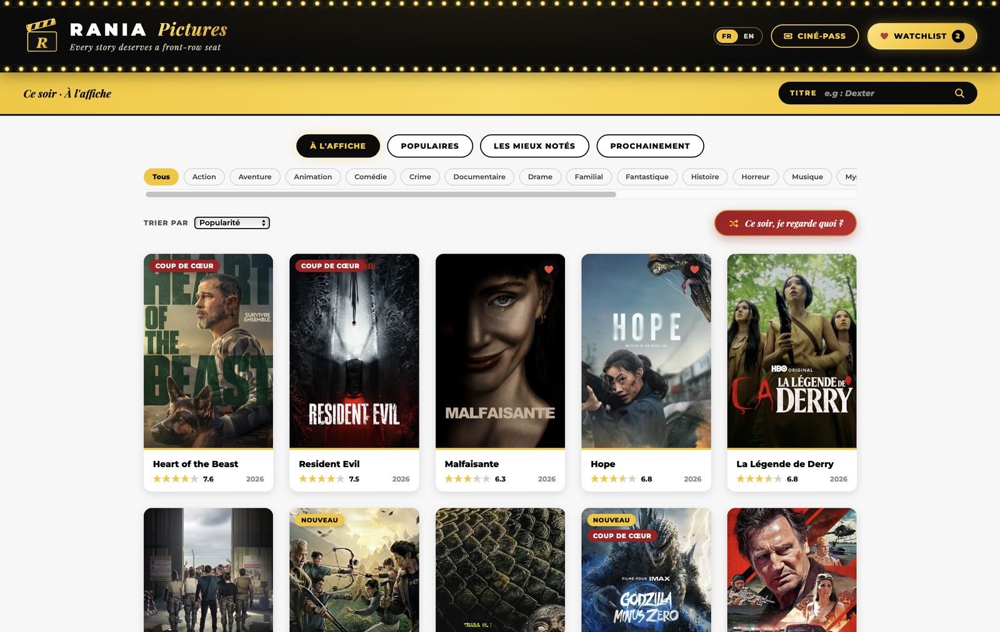
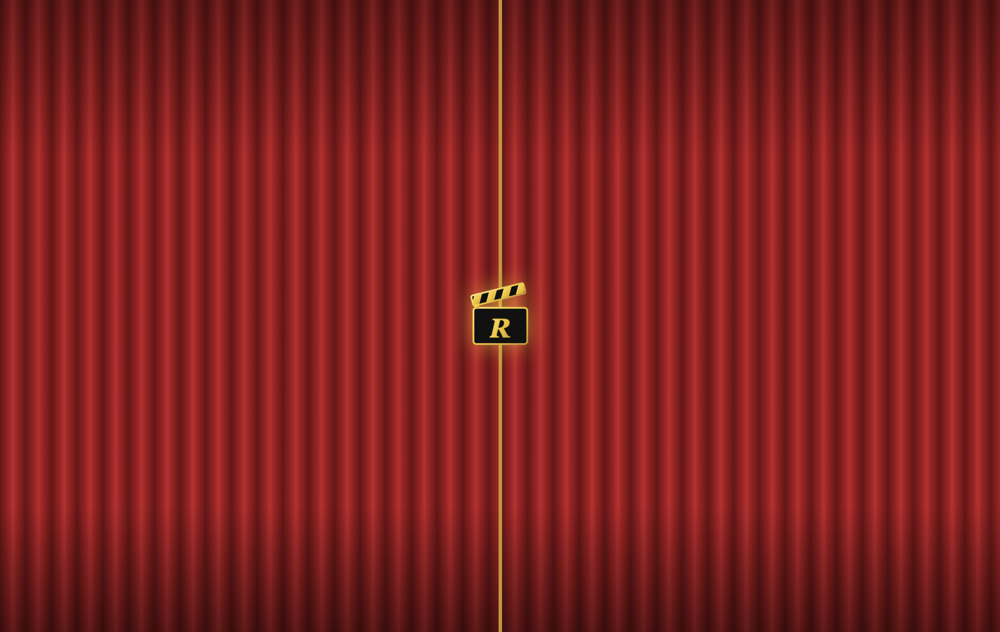
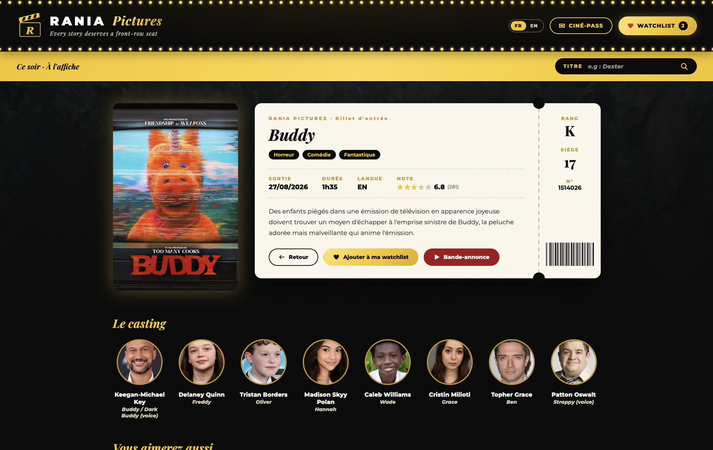
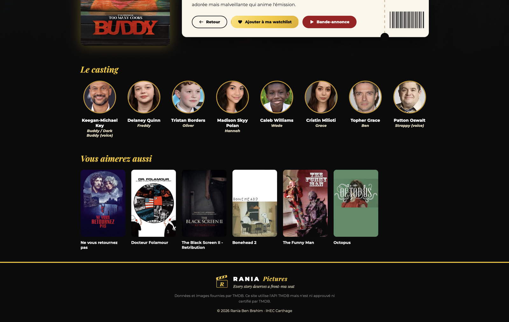
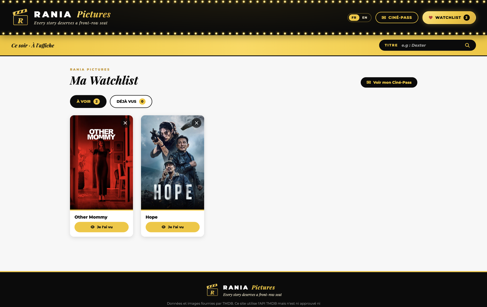
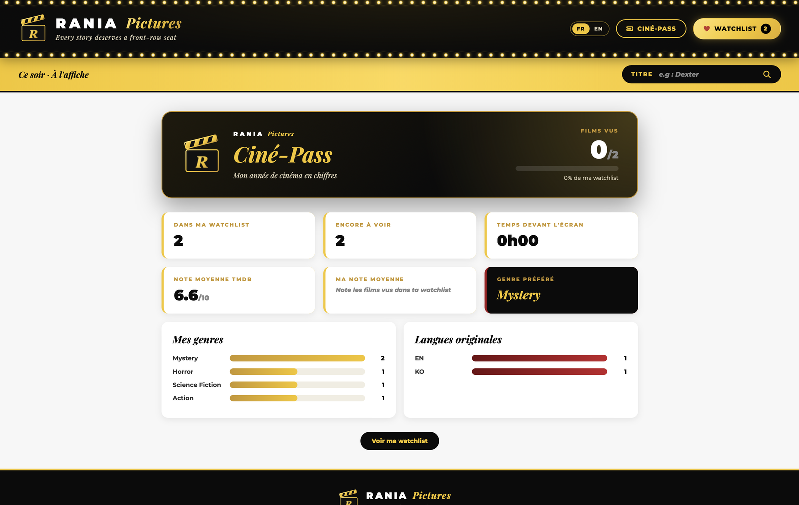

# Rania Pictures

*Every story deserves a front-row seat.*

Application web développée avec **Angular** qui transforme l'API **TMDB** (The Movie Database) en un petit cinéma en ligne : films à l'affiche, fiches présentées comme de vrais billets de cinéma, watchlist personnelle et tableau de bord de mes habitudes de spectatrice.

**Site en ligne :** https://rania-benbrahim.github.io/movie-app/



---

## Aperçu

### Le rideau d'ouverture

À l'arrivée sur le site, un rideau rouge de cinéma s'ouvre sur le logo Rania Pictures.



### Accueil : salles, genres, tri et badges

Quatre salles, des filtres par genre, un tri, des badges *Coup de cœur* et *Nouveau*, des notes en étoiles et le bouton « Ce soir, je regarde quoi ? ».

### Page détail en billet de cinéma

Chaque film est présenté comme un vrai billet : talon détachable avec rang, siège et code-barres, genres, durée, note, résumé et bouton vers la bande-annonce.



### Casting et films similaires



### Watchlist

Les films sont classés en *À voir* et *Déjà vus*. Une fois un film vu, on peut lui donner sa propre note en étoiles.



### Ciné-Pass

Un mini tableau de bord de mes habitudes de spectatrice : progression, temps devant l'écran, notes moyennes, genre préféré, répartition par genre et par langue.



---

## Fonctionnalités

### Identité visuelle
- Univers **Rania Pictures** : logo clap doré, enseigne lumineuse avec ampoules animées, palette jaune, noir et or.
- **Rideau rouge** qui s'ouvre à l'arrivée sur le site.
- Pied de page avec la mention obligatoire de TMDB.

### Catalogue
- **4 salles** : À l'affiche, Populaires, Les mieux notés, Prochainement.
- **Filtres par genre** (Action, Horreur, Comédie...).
- **Tri** par popularité, note, date de sortie ou titre.
- **Recherche en direct** par titre.
- **Badges** sur les affiches : *Coup de cœur* (note supérieure à 7,5), *Nouveau* (sorti depuis moins de 14 jours), compte à rebours *Dans X jours* pour les films à venir.
- **Notes en étoiles** (demi-étoiles comprises).
- **Ajout rapide** à la watchlist avec le cœur sur chaque affiche.
- **« Ce soir, je regarde quoi ? »** : une roulette d'affiches qui choisit un film au hasard.
- **Cartes animées** pendant le chargement.
- **Version française et anglaise** des titres et résumés, avec mémorisation du choix.

### Page détail
- Fiche présentée comme un **billet de cinéma** : talon détachable, rang, siège et code-barres.
- Genres, durée, date de sortie, langue, note et nombre de votes.
- Bouton **Bande-annonce** vers YouTube.
- **Casting** avec photos des acteurs.
- **« Vous aimerez aussi »** : films similaires.

### Watchlist
- Onglets **À voir** et **Déjà vus**.
- Tampon *VU* sur les films regardés.
- **Note personnelle** en étoiles, cliquable.
- Suppression d'un film, compteur dans l'en-tête.
- Sauvegarde dans le navigateur avec `localStorage`.

### Ciné-Pass
Un mini **tableau de bord** de mes habitudes de spectatrice : films vus, progression de la watchlist, temps passé devant l'écran, note moyenne TMDB, ma note moyenne, genre préféré, répartition par genre et par langue originale.

---

## Concepts Angular utilisés

| Concept | Utilisation dans le projet |
|---|---|
| Composants standalone | `head-bar`, `search-bar`, `category-tabs`, `random-pick`, `stars`, `movie-list`, `movie-detail`, `wish-list`, `cine-pass` |
| Service et injection de dépendances | `MovieService` injecté avec `inject()` |
| HttpClient et Observables | Appels à l'API TMDB avec `pipe()`, `map()` et `subscribe()` |
| Signals | `signal()`, `.set()`, `.update()` pour l'état de l'application |
| Computed signals | Liste filtrée et triée, statistiques du Ciné-Pass |
| @Input / @Output | Composant `stars` réutilisable, en lecture ou cliquable |
| Interfaces TypeScript | `Movie`, `MovieResponse`, `Genre`, `CastMember`, `Video` |
| Routing | Routes `/`, `/:id`, `/wishlist`, `/pass`, avec retour en haut de page |
| ActivatedRoute | Lecture de l'identifiant du film dans l'URL |
| Control flow | `@for` avec `track`, `@empty`, `@if`, `@else if` |
| Data binding | Interpolation, property binding, class binding, style binding, event binding |
| Pipes | `DatePipe` pour les dates de sortie |
| localStorage | Watchlist, notes personnelles et langue choisie |
| Animations CSS | Rideau, ampoules, roulette, chargement |

---

## Structure du projet

```
src/app/
├── components/
│   ├── head-bar/        En-tête lumineux, langue, Ciné-Pass et watchlist
│   ├── search-bar/      Recherche par titre
│   ├── category-tabs/   Salles, genres et tri
│   ├── random-pick/     « Ce soir, je regarde quoi ? »
│   ├── stars/           Étoiles réutilisables
│   ├── movie-list/      Grille des films avec badges
│   ├── movie-detail/    Billet de cinéma, casting, films similaires
│   ├── wish-list/       Watchlist à voir / déjà vus
│   └── cine-pass/       Tableau de bord personnel
├── interfaces/
│   ├── movie.ts
│   └── movie-response.ts
├── services/
│   └── movie-service.ts
├── app.routes.ts
└── app.config.ts
```

---

## Installation

```bash
git clone https://github.com/rania-benbrahim/movie-app.git
cd movie-app
npm install
ng serve
```

L'application est ensuite accessible sur http://localhost:4200.

> Une clé API TMDB est nécessaire. Elle se crée gratuitement sur https://www.themoviedb.org et se place dans `src/environments/environment.ts`.

---

## Technologies

Angular, TypeScript, RxJS, HTML, CSS, API REST TMDB, Font Awesome, GitHub Pages

---

## Auteure

**Rania Ben Brahim**
Étudiante en 3e année Business Intelligence, IHEC Carthage
Travail pratique n°3 du cours Angular, année 2026–2027

*Ce produit utilise l'API TMDB mais n'est ni approuvé ni certifié par TMDB.*
